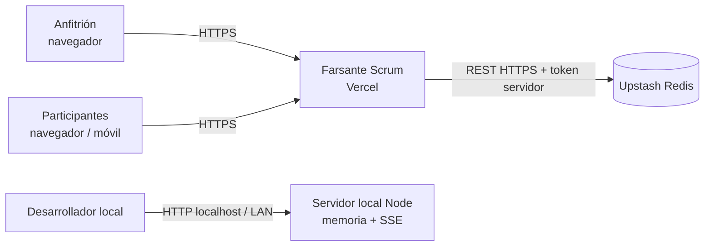
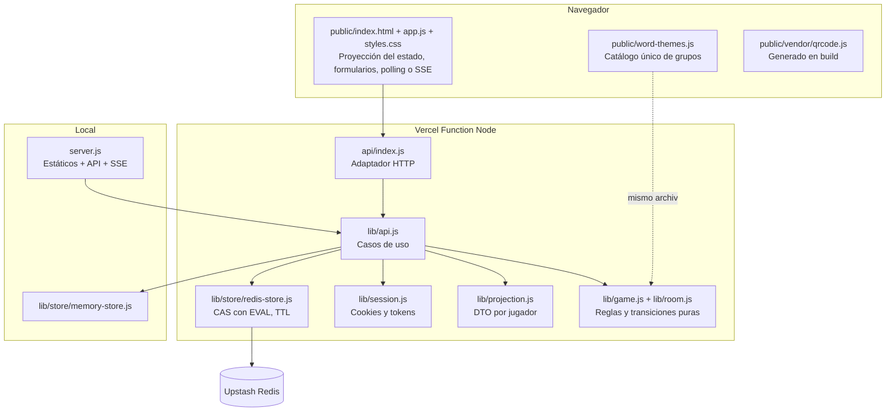

# Arquitectura propuesta — Farsante Scrum

> **Versión:** 0.1.0 · **Estado:** PROPUESTA G2 · Depende de [ADR-0001…0005](../adr/) (PROPUESTOS).
>
> Los diagramas son ayudas de diseño, **no** prueba de implementación (Constitución, Art. X.3). No existe código.

## 1. Contexto (C4 nivel 1)



## 2. Contenedores (C4 nivel 2)



## 3. Responsabilidades por módulo (PROPUESTA)

| Módulo | Responsabilidad | No hace |
|---|---|---|
| `lib/config.js` | Constantes: capacidad 3–12, plazos (90/60/45/75/18/45 s), límites de texto, TTL 6 h, presencia 30 s, intervalo 1,5 s | No contiene secretos |
| `lib/text.js` | Normalización (espacios, mayúsculas, acentos), conteo de grafemas, tokenización | — |
| `lib/room.js` | Crear sala, unirse, salir, transferir anfitrión, validar nombres | Sin E/S |
| `lib/game.js` | Máquina de estados, sorteos, pistas, votos, resultados, `advance(state, now)` | Sin E/S; reloj y aleatoriedad inyectados |
| `lib/reflections.js` | Reflexiones por palabra Scrum y general | — |
| `lib/projection.js` | Documento interno → DTO filtrado por jugador y fase | Nunca serializa el documento completo |
| `lib/session.js` | Emisión de token, hash, cookie, verificación de pertenencia | No registra tokens |
| `lib/store/*.js` | Interfaz común `create`, `read`, `mutate`, `remove`, `touchPresence`, `readPresence`, `ping` | No contiene reglas |
| `lib/store/index.js` | Elegir Redis o memoria; **en Vercel falla si Redis no está configurado** | Sin respaldo en memoria en Vercel |
| `lib/http.js` | JSON, límite de cuerpo, errores redactados, cabeceras de seguridad | — |
| `lib/api.js` | Casos de uso: validar → autorizar → `mutate` → proyectar | Sin lógica de juego propia |
| `api/index.js` | Adaptador Vercel; enrutar `/api/*` y `/health` | — |
| `server.js` | Modo local: estáticos, API, SSE | No se usa en Vercel |
| `public/app.js` | Render localizado, sincronización, foco y anuncios | No decide reglas ni roles |
| `scripts/build.js` | Copiar `qrcode-generator` a `public/vendor/` | — |

**Una sola fuente** de reglas (servidor) y de catálogo (`public/word-themes.js`, cargado también por el servidor). Formato del catálogo para ambos entornos (UMD simple o JSON) se decide en SPEC-FEAT-001/002.

## 4. Máquina de estados

| Estado | Entra por | Acciones permitidas (actor) | Sale a | Plazo |
|---|---|---|---|---|
| `lobby` | crear sala, `reset`, `playAgain` | `join` (visitante), `words` (anfitrión), `leave` (todos), `start` (anfitrión) | `roles` | — |
| `roles` | `start` | `ready` (cada jugador, idempotente) | `clues` cuando todos listos o al vencer | 90 s |
| `clues` | fin de `roles`, `next` desde `reveal` | `clue` (jugador en turno), `skip` (anfitrión) | siguiente turno; tras el último → `discussion` | 60 s por turno |
| `discussion` | último turno | `voting` (anfitrión) | `vote` | 45 s |
| `vote` | fin de `discussion` o `voting` | `vote` (elegible, una vez), `closeVote` (anfitrión con cuórum) | `reveal`, `guess` o `finished` | 75 s o todos votaron |
| `reveal` | empate o sin cuórum | `next` (anfitrión) | `clues` (nueva ronda, nuevo orden) | 18 s |
| `guess` | impostor más votado | `guess` (solo impostor) | `finished` | 45 s |
| `finished` | inocente más votado o fin de `guess` | `playAgain` (anfitrión), `leave` (todos) | `lobby` | — |
| *cualquier activo* | — | `reset` (anfitrión) | `lobby` | — |

### Algoritmo de vencimientos (PROPUESTA)

```text
advance(doc, now):
  repetir como máximo MAX_STEPS (p. ej. 64) veces:
    si doc.phase no tiene plazo o now < doc.game.phaseEndsAt: terminar
    t0 = doc.game.phaseEndsAt          # vencimiento original, no "now"
    aplicar transición por vencimiento con reloj = t0
    el nuevo plazo se calcula desde t0
  si se alcanza MAX_STEPS: registrar evento técnico y detenerse en estado consistente
```

- Toda petición válida (consulta o acción) ejecuta `advance` **antes** de evaluar la acción.
- Una acción recibida después de su plazo se evalúa contra el estado ya avanzado (p. ej. una pista tardía es rechazada por «fuera de turno»).
- `advance` se persiste con la misma escritura atómica que cualquier mutación.

### Invariantes

Un solo impostor; una palabra por partida; orden sin duplicados; una pista por turno; un voto por votante elegible; ningún auto-voto; secretos solo en las fases permitidas; ninguna transición tardía sobrescribe un `reset` (control por `version` y `gameId`); ninguna entrada nueva fuera de `lobby`; toda acción administrativa autorizada en servidor.

## 5. Flujo de una petición (Vercel)

1. `api/index.js` recibe; `lib/http.js` valida método, `Content-Type`, `Origin` (POST) y tamaño (≤ 8 KiB propuesto).
2. `lib/session.js` lee la cookie de la sala y verifica el hash del token contra el documento.
3. `lib/api.js` llama `store.mutate(code, fn)`: `fn` ejecuta `advance` y la acción; si nada cambió, no escribe.
4. `lib/projection.js` genera el DTO del solicitante; respuesta con `Cache-Control: no-store`.
5. Presencia: `touchPresence` separado, con escritura limitada (ver [ADR-0003](../adr/ADR-0003-sincronizacion.md)).

## 6. Modos de ejecución

| Modo | Detección (PROPUESTA) | Almacén | Sincronización |
|---|---|---|---|
| Vercel (Preview/Production) | `process.env.VERCEL` definido | Redis obligatorio; si faltan variables o Redis falla → 503, nunca memoria | Polling ~1,5 s |
| Local compartido | `npm start` con variables `UPSTASH_*` | Redis | Polling o SSE (por decidir en SPEC-008) |
| Local sin Redis | `npm start` sin variables | Memoria del proceso | SSE |

Ver también: [data-model.md](data-model.md) · [api-contracts.md](api-contracts.md).
