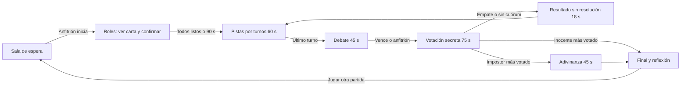

# Actores y recorridos — Farsante Scrum

> **Versión:** 0.1.0 · **Estado:** BORRADOR G1 · Revisión **heurística** del agente; no es un estudio de usabilidad con usuarios reales.

## 1. Perfiles de referencia (SUPUESTO — no son personas reales)

| Perfil | Contexto | Riesgos de experiencia |
|---|---|---|
| Facilitadora (anfitriona) | Abre la sala al inicio de una retro, comparte pantalla, quiere arrancar en < 2 minutos | Revelar su carta al compartir pantalla; no saber por qué no puede iniciar |
| Participante en móvil | Entra por QR desde una sala de reuniones o por enlace en el chat | Teclado virtual tapa la acción; pierde conexión al bloquear el teléfono |
| Participante en portátil | Reunión remota, entra por enlace | Mezclar pestañas o salas; usar lector de pantalla o solo teclado |
| Impostor | Cualquiera de los anteriores | Ver la palabra por error en mensajes o en el HTML; entender su objetivo |

## 2. Recorrido A — Anfitrión crea e invita (SPEC-FEAT-001)

1. Abre la página de inicio, lee una explicación breve y elige **Crear sala**.
2. Escribe su nombre (2–26 caracteres). Grupo por defecto: Scrum y equipo (selector en SPEC-FEAT-002).
3. Recibe la sala de espera con código destacado, enlace copiable y QR.
4. Ve aparecer a los participantes con su estado de conexión en texto y señal visual.
5. Ve el motivo por el que aún no puede iniciar («Faltan 2 participantes», «Ana está desconectada»).

**Fallos considerados:** servidor no disponible al crear; portapapeles bloqueado; QR no generado (se mantiene enlace y código); QR generado desde `localhost` (advertencia).

## 3. Recorrido B — Participante se une (SPEC-FEAT-001)

1. Escanea el QR o abre `/?sala=ABCDE` → el código aparece precargado y el foco va al nombre.
2. Alternativa: abre la página e introduce el código manualmente.
3. Envía su nombre → entra al lobby y ve a los demás.
4. Recarga el navegador → recupera su lugar sin duplicarse.

**Fallos:** sala inexistente o expirada, llena (12), ya iniciada, nombre duplicado, sin conexión, almacenamiento bloqueado o sesión inválida.

## 4. Recorrido C — Partida completa (SPEC-FEAT-003…006)

## 5. Recorrido D — Reinicio y salida (SPEC-FEAT-007)

1. Durante cualquier fase activa, el anfitrión pulsa **Reiniciar partida**; ve que afecta a toda la sala (y, si se aprueba D-15, confirma).
2. Todos vuelven al lobby con código, participantes y palabras guardadas.
3. En el lobby o al finalizar, cualquiera puede **Salir**; si sale el anfitrión, el control pasa al siguiente participante por orden de entrada; al salir el último, la sala se elimina.

## 6. Recorrido E — Fallo de red (SPEC-FEAT-008)

1. La consulta falla → la interfaz muestra «Reconectando…» sin borrar lo visible ni los borradores.
2. Al recuperar, se aplica el estado más reciente; si la fase cambió, se anuncia y el foco se reubica de forma predecible.
3. Si la sesión es inválida o la sala expiró (respuesta definitiva del servidor), se explica y se ofrece volver al inicio. Un 5xx **no** borra la sesión.
