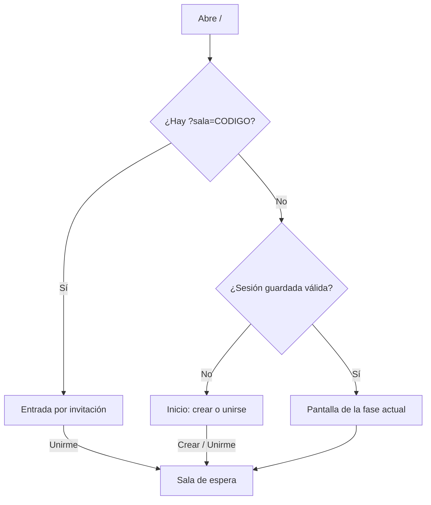

# Flujos, pantallas y estados de interfaz — Farsante Scrum

> **Versión:** 0.1.0 · **Estado:** PROPUESTA G2 · Revisión heurística; sin validación con usuarios reales todavía.

## 1. Objetivos de experiencia (REQUISITO ACORDADO)

- Entender cómo entrar y jugar sin instrucciones verbales extensas.
- Hacer visible el siguiente paso y **quién** puede ejecutarlo.
- No confundir errores de red, rol o fase con un error personal.
- Proteger el secreto y reducir revelaciones al compartir pantalla.
- Facilitar el retorno a la sala y la conversación posterior.

## 2. Mapa de navegación

Aplicación de una sola página (`/`). La pantalla depende de: sin sesión → Inicio o Entrada por invitación; con sesión → la fase de la sala.

Con `?sala=` y una sesión activa en **otra** sala, se aplica D-25 (propuesta: preguntar). Con `?sala=` de la **misma** sala, se recupera la sesión.

## 3. Pantallas y jerarquía

| Pantalla | Información prioritaria | Acción principal | SPEC |
|---|---|---|---|
| Inicio | Qué es el juego (2 líneas), crear o unirse, nombre | Crear sala / Unirme | 001 |
| Entrada por invitación | «Te invitaron a la sala ABCDE», nombre | Unirme al juego | 001 |
| Sala de espera | Código grande, participantes (n/12), anfitrión, conexión, compartir (enlace + QR), grupo guardado, motivo si no se puede iniciar | Iniciar (anfitrión) / Esperar | 001–003 |
| Roles | Advertencia de pantalla compartida, carta oculta, preparados n/N, tiempo | Ver/ocultar carta; «Ya vi mi rol, estoy listo» | 003 |
| Pistas | Jugador en turno, campo «palabra o frase, hasta 160 caracteres», orden, historial, tiempo | Enviar pista (solo en turno); Saltar turno (anfitrión) | 004 |
| Debate | Historial de pistas, tiempo | Abrir votación (anfitrión) | 005 |
| Votación | Candidatos (todos menos uno mismo), selección propia, progreso «4 de 6 votaron» | Confirmar voto; Cerrar votación (anfitrión, con cuórum) | 005 |
| Resultado sin resolución | Empate o falta de cuórum, recuento, identidad oculta | Siguiente ronda (anfitrión) / esperar 18 s | 006 |
| Adivinanza | Impostor descubierto; los demás esperan | Responder (solo impostor) | 006 |
| Final | Ganador, acusado y votos, verdadero impostor, palabra, reflexión y pregunta | Jugar otra partida (anfitrión) / Salir | 006–007 |

**Elementos persistentes en partida:** indicador de conexión, fase y tiempo, botón **Reiniciar partida** (solo anfitrión, estilo de peligro).

**Móvil:** primero la tarea actual; paneles secundarios (lista completa, compartir) debajo o plegables. La carta sigue accesible sin mostrarse por defecto. El QR nunca es la única vía de entrada.

## 4. Catálogo de estados por componente

| Componente | Estados |
|---|---|
| Formulario crear/unirse | inicial, código precargado, validación por campo, enviando (botón bloqueado), error temporal (reintentar, datos conservados), error definitivo (sala inexistente/llena/iniciada, nombre duplicado), éxito |
| Lista de participantes | vacío (solo anfitrión), con anfitrión marcado en texto, «tú», conectado/desconectado con texto + icono, 12/12 llena |
| Compartir | enlace copiado (mensaje en región de estado), portapapeles no disponible (enlace seleccionable), QR listo, QR fallido (alternativa), advertencia `localhost` |
| Botón Iniciar | deshabilitado con motivo visible (faltan N, desconectados), procesando, error |
| Selector de palabras | grupo guardado, borrador sin guardar (distintivo), personalizado, error al guardar, lectura para no anfitriones |
| Carta | oculta, revelada, confirmada, partida reiniciada |
| Pista | fuera de turno, escribiendo (contador de caracteres), enviando, rechazada (motivo junto al campo, texto conservado), vencida, aceptada |
| Voto | sin elección, selección local (editable), enviando, registrado (irreversible), cierre simultáneo |
| Reinicio | confirmación (si D-15), en curso, completado, error con estado preservado, sin permiso |
| Sala/sesión | inexistente, expirada, llena, iniciada, sesión inválida, dependencia caída (recuperable), reconectando |

## 5. Reglas de sincronización en la interfaz

- Actualización **localizada**: no reconstruir el DOM completo cada 1,5 s; conservar valor, cursor, selección, scroll y foco en formularios cuya tarea no cambió.
- Al cambiar de fase: anunciar el cambio en una región de estado, mover el foco al encabezado de la nueva pantalla y descartar formularios obsoletos.
- Descartar respuestas de otra sala, de otra partida (`gameId`) o con versión inferior a la ya aplicada (ver [ADR-0003](../adr/ADR-0003-sincronizacion.md)).
- Bloquear envíos duplicados mientras se procesa una acción (esto no sustituye los controles del servidor).
- Un toast nunca es la única evidencia de un fallo o un resultado crítico.

## 6. Contenido y microcopia (propuesta)

| Situación | Texto propuesto |
|---|---|
| Explicación en Inicio | «Todos reciben la misma palabra, menos uno: el farsante (impostor). Den pistas, debatan y voten para descubrirlo.» |
| Advertencia en Roles | «Si compartes pantalla, deja de compartir antes de ver tu carta.» |
| Impostor | «Eres el impostor. No conoces la palabra: escucha y disimula.» |
| Campo de pista | Etiqueta «Tu pista», ayuda «Palabra o frase, hasta 160 caracteres» |
| Pista con la palabra | «Esa pista revela la palabra secreta. Prueba con otra.» (sujeto a D-13) |
| Inocente acusado | «El equipo señaló a Ana (4 votos). Ana era inocente. El impostor era Luis.» |
| Sin cuórum | «Votaron 3 de 6; se necesitan 4. Nadie fue señalado y el impostor sigue oculto.» |
| Reinicio | «Reiniciar partida: todos volverán a la sala de espera. Se conservan participantes y palabras.» |
| Red | «Reconectando…» / «Conexión recuperada» |
| Servidor no disponible | «No pudimos contactar con el servidor. Tus datos siguen aquí; reintentaremos automáticamente.» |

Nunca mostrar a jugadores términos técnicos (Redis, CAS, DTO, códigos de proveedor).
